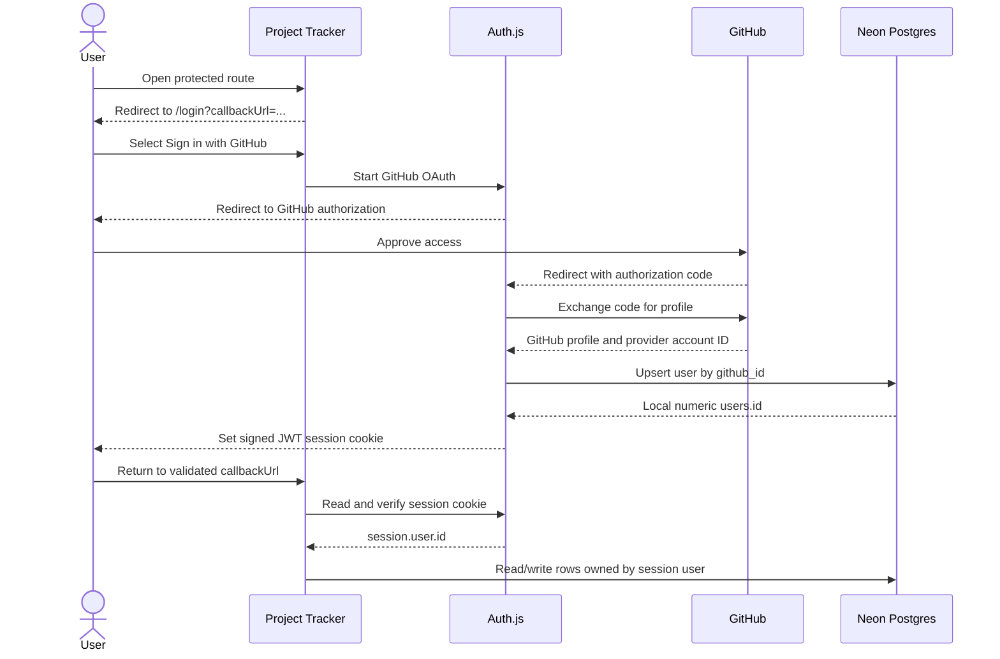

# Project Tracker

A server-rendered project and task tracker backed by Neon Postgres.

## Features

- Create projects and tasks with Zod validation.
- View project progress and manage tasks on a three-column Kanban board.
- Move tasks between statuses optimistically or delete them with confirmation.
- Filter project tasks by priority and title.
- View aggregate task, priority, status, overdue, and project completion statistics.
- Show loading and error states while server-rendered pages load.
- GitHub sign-in with private, per-user projects and tasks.
- View GitHub profile details and delete an account with confirmation.

## Stack

- Next.js 15 App Router and React 19
- TypeScript
- Tailwind CSS
- Neon Postgres with `@neondatabase/serverless`
- Zod for server-side form validation
- Auth.js (NextAuth.js v5) with the GitHub OAuth provider

## Architecture

- App Router pages are React Server Components. They load data on the server and render the home page, project board, and statistics page.
- `src/lib/queries.ts` contains typed read functions. It uses Neon tagged-template SQL so interpolated values are sent as parameters.
- `src/app/actions.ts` contains Server Actions for writes. They validate submitted `FormData` with Zod, execute parameterized SQL, and revalidate affected routes.
- Client form components use React `useActionState`; the Kanban board uses `useOptimistic` for task moves and deletes.
- `src/auth.ts` configures Auth.js with GitHub and upserts users into the `users` table. Its JWT carries the application user ID, which is exposed as `session.user.id`.
- Project reads, statistics, and mutations are scoped to the signed-in user's `owner_id`; server actions verify ownership in the SQL mutation itself.
- `/settings` loads the signed-in user's GitHub profile. Account deletion removes the user row; the schema's cascading foreign keys remove the user's projects and tasks, and the action signs out afterward.
- The `/api/auth/[...nextauth]` route handles OAuth callbacks. The shared `UserMenu` displays the GitHub avatar and name with sign-out, or a sign-in button.
- `src/middleware.ts` redirects unauthenticated requests to `/login` with their original path and query as `callbackUrl`, except for login, Auth.js endpoints, and static assets. After GitHub returns to the Auth.js callback, Auth.js sets the JWT session cookie and sign-in resumes at that URL.
- `next.config.ts` applies clickjacking, MIME-sniffing, referrer, and permissions-policy headers globally, plus HSTS in production.
- `src/lib/callback-url.ts` validates callback destinations as same-site relative paths, falling back to `/` for external or malformed values to prevent open redirects.
- Data pages and project mutation Server Actions call `requireUser()` themselves. Middleware is only a request-level guard: Server Actions can be invoked directly, and matchers can change or be bypassed by other server entry points. Authentication therefore must be checked at the operation that reads or changes private data.
- Aggregate statistics are calculated in SQL using `COUNT`, `FILTER`, and `GROUP BY`; the page only formats the returned counts as simple Tailwind bars.

## Setup

1. Install Node.js 20 or newer.
2. Create a Neon project and database. Copy its pooled or direct Postgres connection string from the Neon dashboard.
3. Create a local environment file:

   ```powershell
   Copy-Item .env.example .env.local
   ```

4. Put the values in `.env.local`:

   ```dotenv
   DATABASE_URL=postgresql://<user>:<password>@<host>/<database>?sslmode=require
   AUTH_SECRET=<generated-secret>
   AUTH_GITHUB_ID=<github-oauth-client-id>
   AUTH_GITHUB_SECRET=<github-oauth-client-secret>
   ```

   Generate `AUTH_SECRET` with `npx auth secret`. Keep `.env.local` private; it is ignored by Git. `.env.example` intentionally leaves every value blank.

5. Create a GitHub OAuth App:

   1. Open **GitHub → Settings → Developer settings → OAuth Apps → New OAuth App**.
   2. Set **Application name** to `Project Tracker`.
   3. Set **Homepage URL** to `http://localhost:3000`.
   4. Set **Authorization callback URL** to `http://localhost:3000/api/auth/callback/github`.
   5. Register the app, copy its client ID into `AUTH_GITHUB_ID`, and generate a client secret for `AUTH_GITHUB_SECRET`.
   6. For deployment, register the deployed site's callback URL too (for example `https://your-domain.example/api/auth/callback/github`) and use the matching GitHub OAuth app credentials in the deployment environment.

## Authentication flow



Auth.js exchanges the short-lived OAuth code for the GitHub identity, persists the profile to `users`, and places the local numeric user ID in its JWT. It sets an encrypted session cookie in the browser; subsequent requests validate that cookie and expose the local ID as `session.user.id`. The app uses that ID to scope project reads and writes. Middleware redirects unauthenticated requests, while pages and Server Actions also check the session themselves.

### Environment variables

| Variable | Purpose | Required |
|---|---|---|
| `DATABASE_URL` | Neon Postgres connection string | Yes |
| `AUTH_SECRET` | Encrypts/signs Auth.js session tokens | Yes |
| `AUTH_GITHUB_ID` | GitHub OAuth App client ID | Yes |
| `AUTH_GITHUB_SECRET` | GitHub OAuth App client secret | Yes |

Never commit `.env.local` or expose OAuth secrets. Rotate credentials if they are disclosed.

6. Create the tables in the Neon SQL Editor:

   ```sql
   CREATE TABLE users (
     id SERIAL PRIMARY KEY,
     github_id TEXT NOT NULL UNIQUE,
     name TEXT,
     email TEXT,
     image TEXT
   );

   CREATE TABLE projects (
     id SERIAL PRIMARY KEY,
     owner_id INTEGER NOT NULL REFERENCES users(id) ON DELETE CASCADE,
     name TEXT NOT NULL,
     description TEXT,
     color TEXT NOT NULL DEFAULT '#6366f1',
     created_at TIMESTAMPTZ NOT NULL DEFAULT NOW()
   );

   CREATE TABLE tasks (
     id SERIAL PRIMARY KEY,
     project_id INTEGER NOT NULL REFERENCES projects(id) ON DELETE CASCADE,
     title TEXT NOT NULL,
     status TEXT NOT NULL CHECK (status IN ('todo', 'doing', 'done')),
     priority TEXT NOT NULL CHECK (priority IN ('low', 'medium', 'high')),
     due_date DATE,
     created_at TIMESTAMPTZ NOT NULL DEFAULT NOW()
   );
   ```

7. If upgrading a database with existing ownerless projects, run [`scripts/backfill-ownerless-projects.sql`](./scripts/backfill-ownerless-projects.sql) once in the Neon SQL Editor after replacing its GitHub ID placeholder with your numeric GitHub account ID. It only updates rows where `owner_id IS NULL` and returns the affected projects.

8. Install dependencies and start the development server:

   ```powershell
   npm install
   npm run dev
   ```

   Open `http://localhost:3000`.

## Validation

```powershell
npm run lint
npm run build
```

## Schema overview

- `users`: serial ID, unique GitHub account ID, and profile name, email, and avatar URL.
- `projects`: serial ID, owner foreign key, name, optional description, display color, and creation timestamp.
- `tasks`: serial ID, project foreign key with cascading delete, title, checked status and priority values, optional due date, and creation timestamp.
